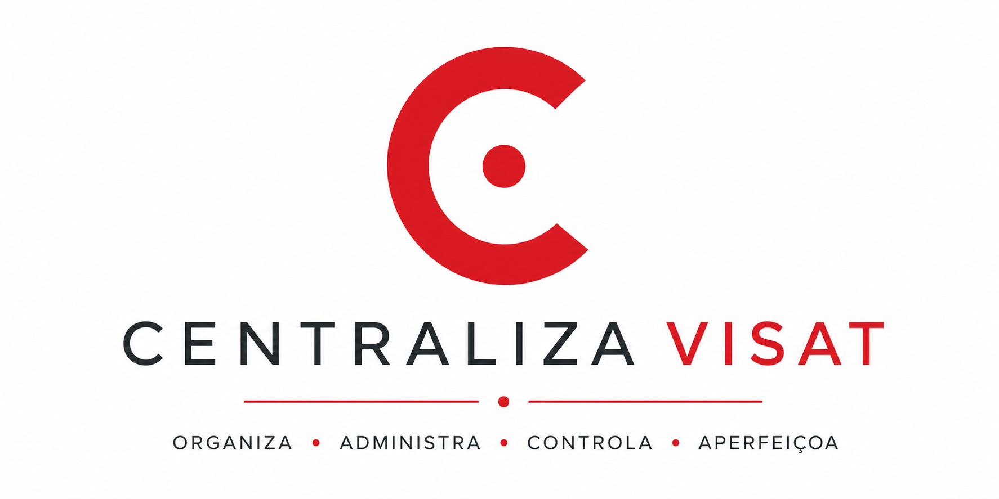
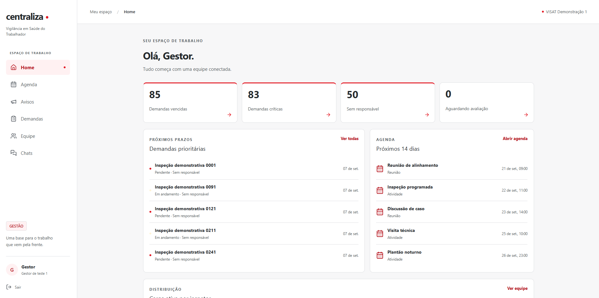
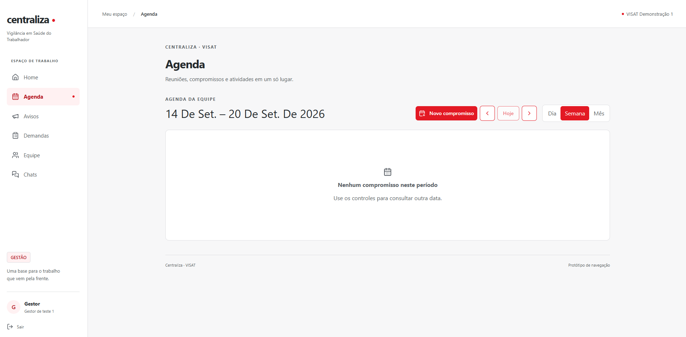
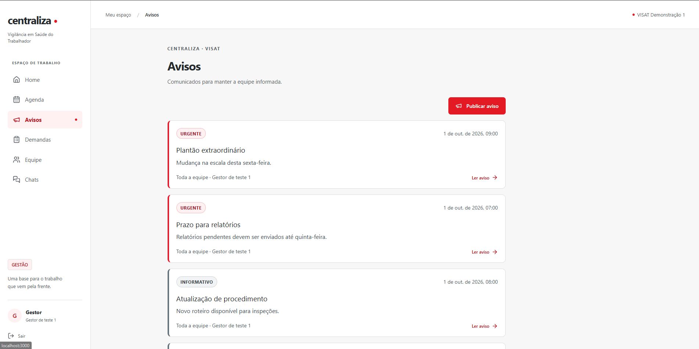
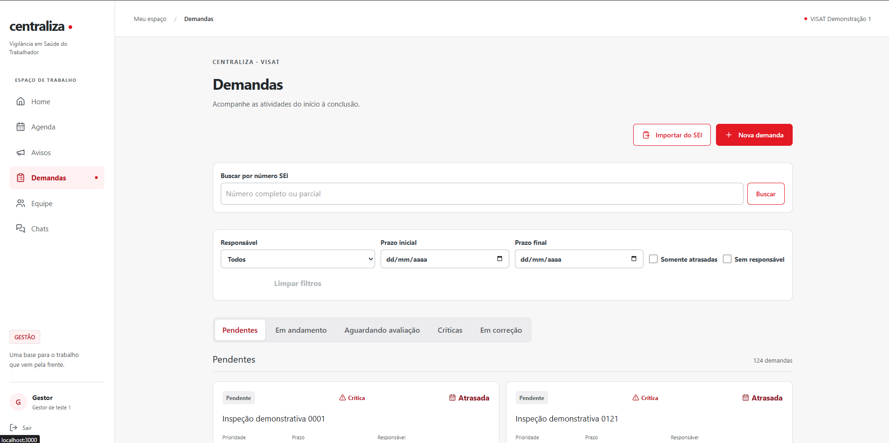
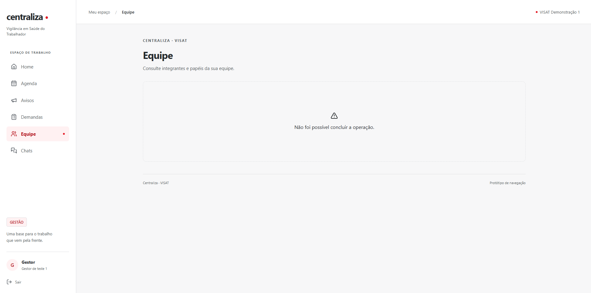
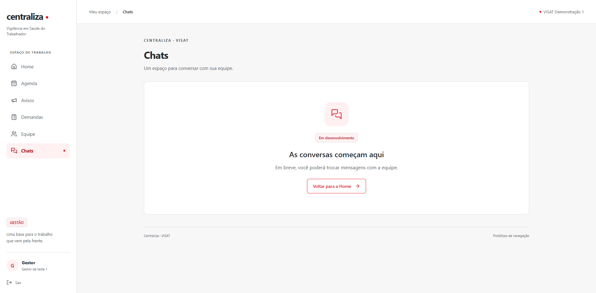

# Centraliza

[▶ Watch the screencast](assets/centraliza-screencast.mp4)

<p align="center">
  
</p>

A shared workspace for Occupational Health Surveillance (VISAT).
Request management, team coordination, and traceability throughout the inspection workflow.

---

## Overview

Centraliza is a web application project for organizing the daily work of VISAT managers and inspectors. Its goal is to bring requests, deadlines, activity records, meetings, and internal communication into one platform.

VISAT receives requests from institutions such as the Public Labor Prosecutor's Office (MPT), the Regional Labor Court (TRT), health councils, and labor unions. Centraliza is intended to help the team follow these requests from assignment through execution and management review.

The repository currently provides authenticated navigation and an operational request workflow backed by a Django API and PostgreSQL, including management review and protected evidence files.

## Core capabilities

Available in the current version:

- **Responsive workspace** — shared layout and navigation across Home, Agenda, Notices, Requests, and Chats.
- **Authenticated roles** — sign in as a manager or inspector using Django sessions protected by CSRF.
- **Request management** — managers can create, edit, assign, reassign, cancel, and filter team requests by assignee, deadline, or overdue state.
- **SEI reference** — every new request requires a process number; normalized duplicates are blocked across teams. Managers can request access to an existing request, and managers of participating teams can approve or reject it.
- **Assisted SEI intake** — managers can paste authorized label-and-value text into a temporary preview, review interpreted fields and possible duplicates, and explicitly confirm request creation; compatibility with the institutional SEI layout remains pending validation.
- **Demonstration browser extension** — on local fictitious SEI pages, a Brave extension reads the visible process number and requesting institution, then opens a separate Centraliza review tab. It does not connect to the institutional SEI.
- **Team directory and account management** — every member can view their own team; explicitly authorized managers can create, edit, activate, and deactivate accounts without accessing another team or deleting records.
- **Role-based operational home** — managers receive team risk and workload indicators, while inspectors receive a personal summary of deadlines, corrections, appointments, and active notices.
- **Request details and history** — inspect complete request data, add timeline comments, submit work for management evaluation, request corrections, approve, or cancel according to role.
- **Protected evidence files** — attach, list, download, and logically remove PDF, JPEG, and PNG evidence through authorized request endpoints, with every change recorded in the timeline.
- **Team agenda** — browse commitments by day, week, or month; managers can create, edit, link requests, select participants, detect schedule conflicts, and cancel entries in Fortaleza time.
- **Team notices** — managers publish, edit, target, schedule, expire, and cancel urgent or informational notices; inspectors receive the active notices authorized for them.
- **Session navigation** — redirect to the entry screen without a valid server session, preserve the session across reloads, and sign out.
- **Accessible interaction** — keyboard navigation, visible focus, a skip-to-content link, descriptive page titles, and checked color contrast.
- **Recovery states** — loading, empty, API error and retry feedback, plus a page-not-found screen.

Planned operational capabilities:

- **Inspection execution** — expand structured progress records beyond comments and evidence files.
- **Team communication** — exchange messages after the operational core is stable.
- **Monitoring** — summarize pending work, overdue requests, critical activities, and team progress.

## Team workspace

The product is designed around two roles. The API currently restricts managers to their team and inspectors to requests assigned to them; the remaining responsibilities describe the product direction.

| Role | Intended responsibilities |
| --- | --- |
| Manager (Gestor) | Organize the team's requests, set priorities and deadlines, assign inspectors, evaluate completed activities, and coordinate meetings and notices. |
| Inspector (Inspetor) | Follow assigned requests, record progress and evidence, submit activities for review, and consult meetings and team communication. |

The planned workflow is assignment, acceptance, execution, management review, and completion. Requests requiring corrections return to execution before a new review.


## Project documentation

The interface and supporting project documents use Brazilian Portuguese:

- [Project website](https://sites.google.com/cesar.school/g3-projetos2/kick-off) — academic context and project presentation.
- [User stories](https://docs.google.com/document/d/16kUCRMTKoWA6baSPuiB9Tu2W-Y0lDQZfsuvdFY4LZjo/edit?usp=sharing) — proposed user needs.
- [User cards + activity diagrams](https://trello.com/b/0qDLqz1F)
- [Pair programming report](https://docs.google.com/document/d/1wDZ5A5P1mDM35wur025545l33LzxW-olVBhIn_phKJM/edit?tab=t.0) — Sprint 1 and Sprint 2 summaries of HU3 (request deadlines, Silvio and Lívia) and HU4 (request priority, Victor and Antônio), including completed work, validation, and next steps.
- [Backlog](https://docs.google.com/document/d/1xlQBoN-2C-LtF59Zb2HhzJUCzOO1bQ3bnZY_P2gJNrY/edit?usp=sharing) — planned features.
- [Development plan](docs/plano-desenvolvimento.md) — tasks, validation process, and Graphify usage.
- [Operational MVP roadmap](docs/plano-mvp-operacional.md) — complete request workflow, protected attachments, managed calendar, notices, and acceptance criteria.
- [Post-MVP evolution plan](docs/plano-evolucao-pos-mvp.md) — SEI-assisted intake, role-specific dashboards, team administration, structured inspections, audit, and rollout.
- [SEI-assisted intake discovery](docs/descoberta-integracao-sei.md) — confirmed decisions, candidate fields, permission questions, anonymization, and Cycle 0 exit criteria.
- [Notices and Status Report plan](docs/semana-5.md) — notice MVP, final regression, code freeze, and demonstration checklist.
- [Navigation foundation](docs/semana-1.md) — responsive routes, guards, and accessibility decisions.
- [Request-list implementation plan](docs/semana-2.md) — data rules, delivery tasks, and completion criteria.
- [Request API contract](docs/contrato-demandas.md) — filters, pagination, access rules, and response format.
- [Visual palette](docs/paleta-visual.md) — red, graphite, and white identity with accessible supporting tones.
- [Screencast of the tests](https://drive.google.com/drive/folders/12SYSir8B1HeT4OVfL2s_kWwH_NuxjDJD?usp=drive_link) — Screencast of the tests for the implemented tasks.


### Home

The Home summarizes deadlines, critical requests, workload, appointments, and active notices for the selected team.



### Agenda

The Agenda centralizes meetings, activities, and other team commitments.



### Notices

Notices provide a single place for urgent and informational team communications.



### Requests

Requests organize the workflow from SEI reference and assignment through execution and review.



### Team

The Team area presents the current members, roles, and team-management context.



### Chats

Chats are reserved as a future communication feature and are currently marked as under development.



## Technology stack

| Area | Technologies and status |
| --- | --- |
| Web interface | React, TypeScript, Vinext/Vite |
| Styling and icons | CSS, Tailwind CSS, Lucide; shadcn components supplied by the starter |
| Authentication | Django session cookie and CSRF protection through a same-origin development proxy |
| Validation | Playwright, axe-core, TypeScript, Oxlint |
| Architecture mapping | Graphify local AST extraction |
| Demo build | Sites starter with Cloudflare Workers build output; Node for local development |
| Back-end | Python, Django, and Django REST Framework |
| Database | PostgreSQL with migrations and reproducible demonstration data |

## Architecture

```text
centraliza/
├── frontend/
│   ├── app/               Routes, metadata, global styles, and error pages
│   ├── components/        Entry screen, workspace layout, and module content
│   ├── hooks/             Authenticated session lifecycle
│   ├── lib/               API clients and navigation configuration
│   ├── public/            Browser assets
│   └── tests/             Navigation, session, and accessibility checks
├── backend/               Django API, models, migrations, tests, and demo seed
├── extension-sei/         Brave extension for local fictitious SEI pages
├── assets/                Project identity
├── docs/                  Planning, contracts, validation, and visual references
└── graphify-out/           Versioned code graph
```

Workspace coordinates session state and chooses the appropriate screen. The session hook calls the API adapter in frontend/lib/auth.ts; layout and module components handle presentation. Request filters call frontend/lib/demandas.ts, and calendar ranges use frontend/lib/agenda.ts. The Django API applies role and team authorization before querying PostgreSQL.

The server is a modular Django application backed by PostgreSQL. It currently enforces authentication, request visibility, active statuses, filters, ordering, and pagination.

With 1,000 demonstration records, the local sequential request-list benchmark measured a 14.79 ms p95 and a constant four SQL queries per request. See the [request-list validation](docs/validacao-semana-2.md) for its method and limitations.

## Local development

Requirements: Node.js 22.13 or later, npm, Python 3.12 with uv, and PostgreSQL 16 or later. Configure the database variables from `backend/.env.example`.

The prepared Windows workspace uses an isolated PostgreSQL instance on port `55432`. Start it from the repository root:

```powershell
& '.\.local\postgresql\pgsql\bin\pg_ctl.exe' start `
  -D '.\.local\pgdata' `
  -l '.\.local\postgresql.log' `
  -o '-p 55432 -h 127.0.0.1' `
  -w
```

Then prepare and start the API:

```powershell
cd backend
uv sync
uv run python manage.py migrate
$env:CENTRALIZA_DEMO_PASSWORD = "Centraliza@2026"
uv run python manage.py seed_demo --total 30
uv run python manage.py seed_agenda
uv run python manage.py seed_avisos
uv run python manage.py runserver
```

In another terminal, start the interface:

```powershell
cd frontend
npm ci
npm run dev
```

Open the address printed by the terminal, normally http://localhost:3000. The frontend proxies `/api` to http://127.0.0.1:8000. Set `CENTRALIZA_API_URL` before starting the frontend to use another local API address.

### Try the SEI capture demonstration in Brave

With the API and frontend running on their default local addresses, open `brave://extensions`, enable **Developer mode**, choose **Load unpacked**, and select the repository's `extension-sei` folder. Open [the fictitious process page](http://localhost:3000/mock-sei/processo.html). A small Centraliza notice offers **Revisar no Centraliza**; you can also click the extension icon and select **Enviar para revisão**. A new Centraliza tab opens with the process number and requesting institution ready for review. If you are signed out, log in in that new tab; the captured fields stay there until you save or cancel. Closing the tab discards the unsaved capture. If the extension was already installed, use **Reload** on `brave://extensions` to get the latest version.

The [fictitious document page](http://localhost:3000/mock-sei/documento.html) also shows the notice and demonstrates the distinction between process and document numbers. The [ambiguous example](http://localhost:3000/mock-sei/ambiguo.html) asks for manual correction. These pages contain demonstration data only. Remove the extension from `brave://extensions` when finished. The extension is restricted to `localhost:3000`; a real SEI page requires an authorized adapter and validation against anonymized examples. Government domains alone are not used to trigger the notice.

### Demonstration accounts

These credentials are only for fictitious local development data. All six accounts currently use `Centraliza@2026`.

| Profile | Usernames |
| --- | --- |
| Manager | `demo.gestor.1`, `demo.gestor.2` |
| Inspector | `demo.inspetor.1`, `demo.inspetor.2`, `demo.inspetor2.1`, `demo.inspetor2.2` |

`seed_demo` sets the password when it creates an account. It preserves the password of an account that already exists, so changing `CENTRALIZA_DEMO_PASSWORD` alone does not reset existing users.

Run the complete validation from the corresponding directories:

```powershell
cd backend
uv run python manage.py test
uv run python manage.py benchmark_demandas --requests 30 --warmup 5

cd ../frontend
npm run lint
npm run typecheck
npm run build
npm test
```

Browser tests use an installed Microsoft Edge. Adjust the channel in frontend/playwright.config.ts for another environment. Generated starter components in components/ui and hooks/use-mobile.ts are excluded from the application lint configuration.

For code exploration, run graphify explain Workspace from the repository root. After source changes, run graphify update . --no-cluster to refresh graphify-out/graph.json. This mode analyzes code locally and does not send it to an external model.

## Data and security

- Demonstration records and accounts are fictitious and do not contain institutional data.
- Django enforces permissions by role, team, assignment, participant, recipient, and validity period; browser guards only control navigation feedback.
- Request transitions and their history are written through transactional backend services.
- Real deployment requires secret rotation, HTTPS, a production application server, persistent protected storage, backup and restore, attachment scanning, monitoring, and agreement on operational access rules with VISAT.

## Product direction

The operational MVP now covers the complete request lifecycle, protected evidence, managed scheduling, and managed notices. The next stage is production hardening and integrated acceptance with VISAT. Account administration, dashboards, notifications, and chat remain later product increments.


## Team

| Member | Role | Contact |
| --- | --- | --- |
| Antônio Marcos Soares de Araujo Filho | Developer | [LinkedIn](https://www.linkedin.com/in/antonio-m-29aa4a3b0/) |
| Arthur Florêncio Afonso de Albuquerque | Tech Leader | [LinkedIn](https://www.linkedin.com/in/arthur-flor%C3%AAncio-afonso/)<br>[arthurafonsodev@gmail.com](mailto:arthurafonsodev@gmail.com) |
| Cecília de Moraes Andrade Oliveira | Quality Assurance | [LinkedIn](https://www.linkedin.com/in/ceciliademoraesa) |
| Lívia Cabral da Mata Buonora | Developer | [LinkedIn](https://www.linkedin.com/in/l%C3%ADvia-buonora-381294365/) |
| Luiza Beltrão Pereira de Melo | Quality Assurance  | [LinkedIn](https://www.linkedin.com/in/luiza-beltr%C3%A3o-pereira-de-melo/) |
| Silvio Ronaldo de Lima Lobo Filho | Developer | [LinkedIn](https://www.linkedin.com/in/silvio-lobo-a836b6393/) |
| Victor Bacelar Palazzin | Developer | [LinkedIn](https://www.linkedin.com/in/victor-bacelar-palazzin-a444a23b0/) |

## Sprint 01 — Delivered work

The [Centraliza Trello board](https://trello.com/b/0qDLqz1F/centraliza) marks the following 21 user-story cards complete as of October 29, 2026. They describe the capabilities available in the MVP; the development completed during this sprint is detailed below.

### User stories

| Area | Completed stories |
| --- | --- |
| Intake and assignment | [HU 1 — Create requests](https://trello.com/c/PP6Srufr), [HU 2 — Assign an inspector](https://trello.com/c/20UtshZM), [HU 21 — Reassign a request](https://trello.com/c/ZsAP8Nxy) |
| Planning and visibility | [HU 3 — Set a deadline](https://trello.com/c/QzEjh9j8), [HU 4 — Set a priority](https://trello.com/c/dwC60dL3), [HU 5 — View pending requests](https://trello.com/c/oTczSDYh), [HU 6 — View request details](https://trello.com/c/WTH98bR8), [HU 15 — View team requests](https://trello.com/c/r8QbrIBr) |
| Execution and evidence | [HU 7 — Accept a request](https://trello.com/c/AHWtBINM), [HU 8 — Start execution](https://trello.com/c/Kb2d6Uo0), [HU 9 — Update status](https://trello.com/c/3irjFpoO), [HU 10 — Attach files](https://trello.com/c/dZpusIoG), [HU 19 — Add notes](https://trello.com/c/doT7QbZ9), [HU 20 — View history](https://trello.com/c/AOki27tj) |
| Review | [HU 12 — Submit for review](https://trello.com/c/oK3QeUrP), [HU 13 — Approve a request](https://trello.com/c/IcEuxZLE), [HU 14 — Request corrections](https://trello.com/c/yJ50KhDD) |
| Calendar | [HU 23 — View team calendar](https://trello.com/c/gEAkYZZx), [HU 24 — View appointments](https://trello.com/c/n9lZUCNn), [HU 25 — View meetings](https://trello.com/c/zS9MQeJh) |
| Notices | [HU 30 — Mark a notice as read](https://trello.com/c/iYo4UpLH) |

### Development completed in Sprint 01

- **HU 3 — Deadline rules:** [PR #1](https://github.com/arthur-afonso-GIT/centraliza/pull/1) added date-and-time deadlines, authorized changes by managers and assigned inspectors, migration of existing dates, deadline history, filters, and regression tests. The [Sprint 01 Trello card](https://trello.com/c/erYbOOBp) is complete.
- **HU 4 — Priority rules:** [PR #2](https://github.com/arthur-afonso-GIT/centraliza/pull/2) added the inspector's priority control, role and request-state checks, history, and backend and browser tests. The [Sprint 01 Trello card](https://trello.com/c/vRTkq5AX) is complete.
- **HU 16 — Overdue requests:** [PR #3](https://github.com/arthur-afonso-GIT/centraliza/pull/3) added overdue indicators and elapsed-time display to the request list and detail, plus tests. The [Sprint 01 delivery card](https://trello.com/c/Qy3IoWrx) is complete; the separate general HU 16 card has not yet been marked complete on Trello.
- **HU 9 — Status updates:** the [status-control change](https://github.com/arthur-afonso-GIT/centraliza/commit/7280fb576d7481a5736e8aff6c839e57c0ce1521) added a dedicated inspector control driven by allowed API transitions, including delivery-summary validation and immediate updates to the request history. The [Sprint 01 rules card](https://trello.com/c/MhxHBBsq) remains open, so its final business-rule review is not recorded as complete.

Sprint 01 also produced API contracts, migrations, automated backend and browser coverage, and [pair-programming notes](https://docs.google.com/document/d/1wDZ5A5P1mDM35wur025545l33LzxW-olVBhIn_phKJM/edit?tab=t.0). The [sprint plan](docs/plano-acao-sr2.md) still calls for an integrated smoke test against the real frontend, API, and PostgreSQL; the individual feature tests do not replace that acceptance check.

The [MVP Sprint 1 milestone](https://trello.com/c/vWy50e6j) is marked complete on Trello. The repository also contains the initial SEI capture demonstration: a Brave extension reads fields from fictitious process and document pages, opens a Centraliza review tab, and requires manager confirmation before creating a request. This is a local prototype, not an integration with the institutional SEI.

### Sprint evidence


