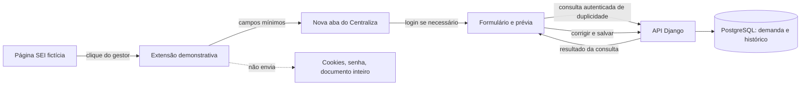

# Plano de desenvolvimento — captura assistida do SEI

**Estado:** proposta de execução para demonstração com dados fictícios. O fluxo de uma captura por aba, login e revisão foi confirmado. O primeiro mock deve preencher o número do processo SEI e a instituição demandante no campo existente `Demanda.origem`. Se o número não for identificado com segurança, há aviso e preenchimento manual. Demandas duplicadas pelo número do processo devem ser bloqueadas globalmente; gestores de outras equipes veem apenas número SEI, nome da demanda e origem antes de solicitar participação. Qualquer gestor de uma equipe já participante pode aprovar/recusar em uma lista de solicitações pendentes.

## 1. Contexto e objetivos

O Centraliza já permite criar demandas manualmente e gerar uma prévia a partir de texto colado. A próxima entrega deve demonstrar a captura do **número de recebimento/processo SEI** e de sugestões de campos visíveis, a partir de uma página fictícia que represente uma página de processo. A extensão identifica os campos e oferece **Enviar**; uma nova aba do Centraliza abre (com login primeiro, se necessário) e mostra os campos preenchidos para o gestor corrigir e salvar. Não há acesso à API do SEI nem a uma página institucional disponível para desenvolvimento.

Toda demanda nova deve ter o número SEI. Os registros atuais são fictícios; uma migração de dados reais não faz parte do escopo. A demonstração não comprovará compatibilidade com a instalação institucional.

**Aceite global:**

- Um gestor parte da página SEI simulada, usa Enviar na extensão e recebe **uma nova aba de preenchimento exclusiva daquela captura**, sem modificar abas do Centraliza já abertas. Ele vê o número e as sugestões preenchidos, corrige o necessário e salva sem redigitar o número. Os dados aguardam na própria aba durante o login; fechar sem salvar descarta o progresso.
- A extensão não cria demanda por conta própria; exige sessão e confirmação do gestor no Centraliza.
- Demanda sem número é recusada tanto na criação manual quanto na confirmação da prévia, inclusive por chamada direta à API.
- Campo ausente ou ambíguo é mostrado como pendência, sem adivinhar um número; nenhuma página completa, credencial ou cookie é enviada.
- A demonstração permite medir tempo e erros de cadastro. A taxa de conclusão operacional é definida e exibida separadamente, após validação do denominador com a equipe.

## 2. Diagnóstico investigativo da base

| Área | Estado verificado | Consequência |
| --- | --- | --- |
| Interface | `frontend/components/demanda-form.tsx` trata `sei_numero` como opcional; `frontend/components/importar-sei.tsx` já oferece colagem, prévia editável e confirmação. | Reaproveitar a revisão existente; atualizar entrada manual e textos. |
| Contrato frontend | `frontend/lib/demandas.ts` contém os tipos e chamadas da prévia. | A ponte da extensão deve terminar nesse contrato ou em um adaptador explícito, evitando duplicar formulários. |
| API | `backend/config/urls.py` expõe criação de demandas, consulta de duplicidade e criação/edição/confirmação/descarte da prévia. | Há um destino lógico para a captura, mas o contrato atual de prévia recebe `texto`, não campos estruturados da extensão. |
| Domínio | `backend/demandas/models.py` permite número vazio; `backend/demandas/serializers.py` o aceita na demanda; `backend/demandas/identidade_sei.py` normaliza para busca. `Demanda.origem` é texto livre. | A obrigatoriedade precisa ser aplicada de forma coerente no serviço/API e no modelo após tratar os dados fictícios; `origem` será a instituição demandante no produto. |
| Parser | `backend/demandas/importacao_sei.py` interpreta rótulos fictícios `Rótulo: valor`. | Serve para o mock; não deve ser apresentado como adaptador comprovado do SEI real. |
| Duplicidade | A API e a interface avisam sobre o mesmo número, mas a confirmação ainda pode criar outra demanda. | Foi escolhida unicidade global por processo; exige bloqueio transacional/banco e um fluxo de descoberta/participação entre equipes. |
| Persistência | `ImportacaoSei` guarda texto bruto por 24 h e o remove em confirmação, descarte ou acesso após vencimento. | Falta definir limpeza ativa das prévias expiradas e retenção antes de uso institucional. |
| Testes | Há testes Django para parser, prévia, permissões, duplicidade e confirmação, e Playwright para o fluxo de colagem. | Ampliar cenários de contrato e ponta a ponta; preservar esses testes. |

O fluxo de demandas, Home, agenda, avisos e equipes usa Django/DRF com PostgreSQL e frontend React/TypeScript com vinext. A autenticação é por sessão e CSRF. O frontend local encaminha `/api` à API Django. Não existe extensão no repositório. Os documentos `docs/descoberta-integracao-sei.md` e `docs/plano-evolucao-pos-mvp.md` já registram a dependência de amostras anonimizadas e autorização institucional para uma captura real.

**Riscos de regressão:** exigir número no modelo quebra cargas e testes que criam demandas sem esse campo; aceitar dados de uma extensão diretamente na API pode contornar a revisão, as permissões e o CSRF; tratar número de documento como número de processo pode associar a demanda errada. As alterações de interface já presentes no diretório de trabalho devem ser preservadas durante a execução deste plano.

## 3. Blueprint arquitetural

**Fronteiras:** a extensão lê apenas a página simulada e entrega dados candidatos à nova aba; **o Centraliza autenticado**, não a extensão, consulta a API para verificar duplicidade e preparar a prévia. A aplicação valida sessão, equipe e perfil; o gestor corrige no Centraliza; a API cria a demanda somente depois de salvar. A página de documento será uma segunda fonte de captura, depois da prova na página de processo. O número do documento não substitui silenciosamente o número do processo.

**Contrato proposto da captura:** número de processo SEI e instituição demandante são os dois campos preenchidos automaticamente no primeiro mock, com indicação de valores não encontrados. A instituição é armazenada em `Demanda.origem`, sem novo campo. O contrato definitivo deve definir limites de tamanho e formato; nenhum HTML integral é necessário. `ImportacaoSei.origem` é outro campo, que identifica o canal (`texto`/`extensao`) e não deve ser confundido com a instituição demandante. O endpoint atual de prévia só recebe texto e **persiste** um registro temporário. Como foi escolhido não criar rascunho no banco para a captura da extensão, a prévia estruturada precisará de um contrato sem persistência, preservando o fluxo atual de texto colado.

**Decisões pendentes, sob controle do usuário:**

1. O fluxo foi decidido: a extensão entrega **somente à aba recém-criada para a captura**, sem preencher abas existentes; a aba preserva os campos durante o login, limpa a captura ao salvar/cancelar e descarta trabalho não salvo ao fechar. Para o protótipo no Brave, a extensão cria uma aba de recebimento do Centraliza, usa o ID retornado para executar uma entrega pontual dos dois campos apenas nessa aba, e a página os guarda em `sessionStorage` antes do login. Após autenticar, o Centraliza consulta a API. Não colocar campos na URL nem criar rascunho no banco. Validar compatibilidade e permissões no protótipo.
2. O identificador obrigatório foi definido como número do processo SEI. Se estiver ausente ou ambíguo (por exemplo, diante de um número de documento), mostrar aviso e exigir entrada manual. O formato real continua pendente de amostras institucionais.
3. Foi decidido bloquear nova demanda com o mesmo processo **globalmente**. Um gestor de outra equipe vê apenas número SEI, nome da demanda e origem/instituição demandante para reconhecer o processo e solicitar participação. Histórico, anexos e detalhe integral permanecem restritos. Qualquer gestor de equipe já participante aprova/recusa em uma solicitação pendente.
4. **Brave** é o único navegador exigido na primeira demonstração; os demais serão uma etapa de compatibilidade, não uma promessa sem teste.
5. Fórmula e período da taxa de conclusão, para não misturar desempenho da captura com resultado operacional.

**Trade-off:** começar pela colagem assistida exigiria menos código, mas não demonstraria a captura desejada; começar por seletores reais sem amostras seria frágil e impossível de validar. Uma extensão sobre página fictícia demonstra a experiência e isola o adaptador que será substituído após a descoberta institucional.

## 4. Roadmap sequencial

Cada fase entrega algo demonstrável e pode ser validada isoladamente. Não iniciar uma decisão pendente por suposição.

### Fase 0 — Fechar decisões e critérios

- [ ] Registrar exemplos fictícios de número de processo e número de documento, inclusive casos ambíguos; exigir aviso e entrada manual quando a extração não for confiável. Usar `Demanda.origem` para instituição demandante e avaliar rótulo visível “Demandante” nos formulários e detalhes.
- [ ] Escolher a ponte extensão → aba do Centraliza e desenhar descoberta/participação entre equipes para unicidade global; documentar o comportamento sem sessão ou sem acesso à demanda completa. Usar armazenamento temporário da aba para preservar a captura durante o login e descartar ao fechar sem salvar.
- [x] Definir Brave como primeiro navegador-alvo.
- [ ] Definir a fórmula da taxa de conclusão.
- [ ] Atualizar `docs/descoberta-integracao-sei.md` e este plano com as decisões; marcar o que ainda depende de amostras reais.

**Aceite:** uma pessoa consegue descrever o fluxo do clique até a confirmação, incluindo falha de extração, sessão expirada e processo já existente.

### Fase 1 — Número obrigatório em novas demandas

- [x] Exigir número SEI na criação pela API e no modelo; preservar a normalização atual para comparar números equivalentes.
- [ ] Aplicar a constraint única global de `sei_numero_normalizado` no PostgreSQL local (migração `0011` gerada; serviço indisponível nesta sessão). A API já trata colisões com erro de validação.
- [x] Adequar os fixtures/testes que criavam demandas sem número. `seed_demo.py` já fornece números fictícios exclusivos.
- [x] Atualizar o formulário de criação, o rótulo de demandante e os testes correspondentes.

**Aceite:** criação manual e importada sem número falham na API; a interface explica como corrigir; o restante das demandas continua navegável.

### Fase 1A — Descoberta e solicitação de participação entre equipes

- [x] Consulta exata por número SEI para gestores autenticados, com resumo mínimo para equipes ainda não participantes.
- [x] Solicitação de participação com estado, auditoria e fila de decisões para gestores de equipes participantes; decisões são serializadas pelo bloqueio da demanda no PostgreSQL.
- [x] Vincular a equipe aprovada em `equipes_participantes`, sem duplicar a demanda; detalhe, anexos e histórico continuam protegidos antes da aprovação.
- [x] Cobrir consulta, repetição, aprovação, recusa e ausência de permissão em testes Django e Playwright.

**Aceite:** número já cadastrado impede nova criação, mostra caminho autorizado para a demanda existente e permite solicitar participação sem revelar dados além do escopo decidido.

### Fase 2 — Contrato de prévia para captura estruturada

- [x] Validar campos estruturados na aba do Centraliza, sem rascunho no banco; a checagem autenticada de duplicidade usa a consulta existente e a criação usa a API normal após revisão.
- [x] Reusar normalização e consulta de duplicidade; valor ausente ou ambíguo é mostrado para correção manual. O canal da extensão fica na aba, sem criar `ImportacaoSei` persistida.
- [ ] Definir descarte/expiração e limpeza ativa do conteúdo temporário; limitar o dado persistido ao necessário.
- [x] Adicionar rota dedicada `/captura-sei` e preservar o fluxo de texto colado existente.

**Aceite:** texto colado e captura simulada chegam à mesma revisão; nenhuma entrada cria demanda antes da confirmação; perfil ou equipe indevidos são recusados.

### Fase 3 — Página fictícia e extensão demonstrativa

- [x] Criar páginas fictícias de processo, documento e ambiguidade.
- [x] Criar extração testável e extensão com permissão restrita ao ambiente local; não ler cookies, senhas ou corpo completo de documentos.
- [x] Entregar campos apenas à nova aba, com aviso para número ausente ou ambíguo e retorno à revisão após login.
- [x] Documentar instalação e remoção da extensão no Brave no README.

**Aceite:** no Brave, o gestor inicia no mock, vê a prévia no Centraliza, corrige e confirma; mudanças incompatíveis no HTML do mock resultam em erro explícito, sem cadastro silencioso.

### Fase 4 — Validação do fluxo e medição

- [ ] Executar o roteiro com um gestor e um inspetor do grupo: captura/criação, atribuição, aceite, execução e conclusão; registrar dificuldades sem usar dados reais.
- [ ] Comparar tempo e erros de entrada manual com entrada pela extensão no mesmo conjunto fictício.
- [ ] Implementar a taxa de conclusão somente após fechar sua fórmula e período; verificar se o numerador e denominador respeitam equipe e perfis.
- [ ] Revisar usabilidade, acessibilidade e documentação; separar claramente “mock demonstrado” de “compatibilidade SEI validada”.

**Aceite:** a equipe consegue repetir o fluxo e entender os resultados das duas medidas sem confundi-las.

### Fase 5 — Caminho para o SEI institucional (fora do aceite do mock)

- [ ] Obter autorização e 3–5 amostras anonimizadas de páginas de processo/documento utilizadas pela VISAT.
- [ ] Validar campos permitidos, estrutura das páginas, variações de navegador, instalação/distribuição da extensão e retenção dos dados.
- [ ] Criar adaptador específico versionado e testes com amostras anonimizadas; testar com usuário autorizado em ambiente controlado.

**Aceite futuro:** números e campos são extraídos corretamente nas variações aprovadas; mudanças da página falham de forma segura. Sem essas evidências, não declarar integração real pronta.

## 5. Estratégia de testes e validação

- **Unidade:** identificação e distinção entre número de processo/documento; normalização; ausência e ambiguidade; resistência a mudanças de marcação na página fictícia.
- **API:** obrigatoriedade por criação manual e importação; perfil/equipe; CSRF; confirmação única; descarte/expiração; duplicidade segundo a decisão da Fase 0; não exposição do conteúdo bruto.
- **Ponta a ponta:** página mock → extensão → revisão → demanda; sessão expirada; captura incompleta; fluxo de colagem preservado; teclado e acessibilidade da prévia.
- **Comandos locais:** em `backend`, `uv run python manage.py test` (ou `backend/.venv/Scripts/python.exe manage.py test` no ambiente preparado); em `frontend`, `npm run typecheck`, `npm run lint`, `npm run build` e `npm test`. O teste manual da extensão no navegador-alvo complementa os testes automatizados.

Estado de validação em 2026-10-10: as migrações `0011` e `0012` foram aplicadas no PostgreSQL local após preencher os registros fictícios `seed-v1`. Os 100 testes Django, 56 testes de navegador, checagem de tipos, lint, build e quatro testes da extensão passaram. Um teste automatizado com o Brave instalado carregou a extensão e confirmou que o popup leu a página fictícia, abriu uma nova aba e preservou os dois campos após login real na conta fictícia. O uso interativo por uma pessoa e a compatibilidade com o SEI institucional continuam pendentes.

## 6. Contingência e rollback

- O fluxo manual e a colagem assistida permanecem utilizáveis enquanto a extensão é desenvolvida. A extensão demonstrativa pode ser desinstalada sem alterar demandas existentes.
- A entrada estruturada será isolada da entrada textual existente, com testes de contrato antes de ser habilitada para a interface.
- A regra de número obrigatório será aplicada após ajustar apenas os dados fictícios; migração de banco, se necessária, será reversível. Para qualquer uso real futuro, exigir plano próprio de migração, retenção e autorização.
- Em caso de falha na captura, a prévia fica incompleta ou não é criada; o gestor pode inserir o número manualmente. A API mantém a validação final.
